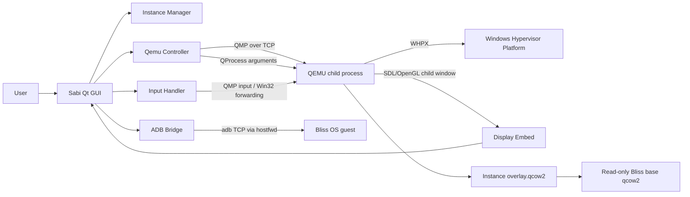
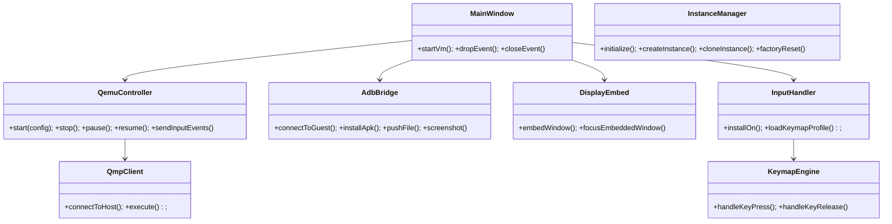
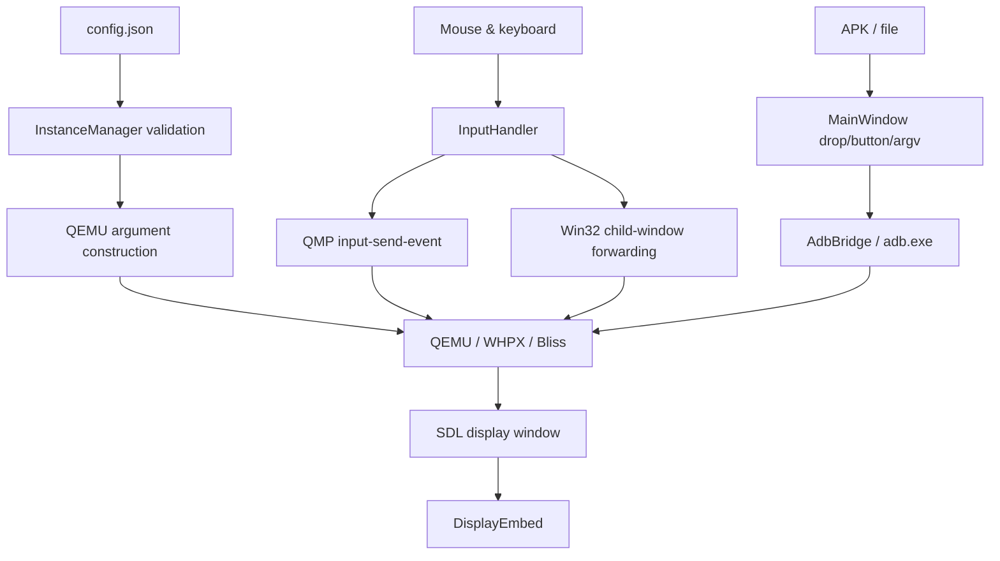
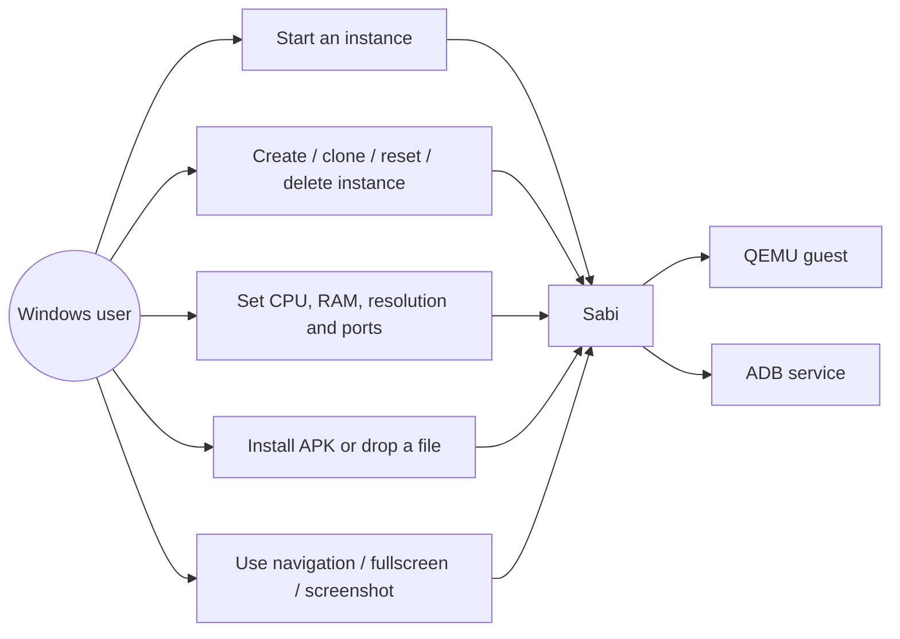
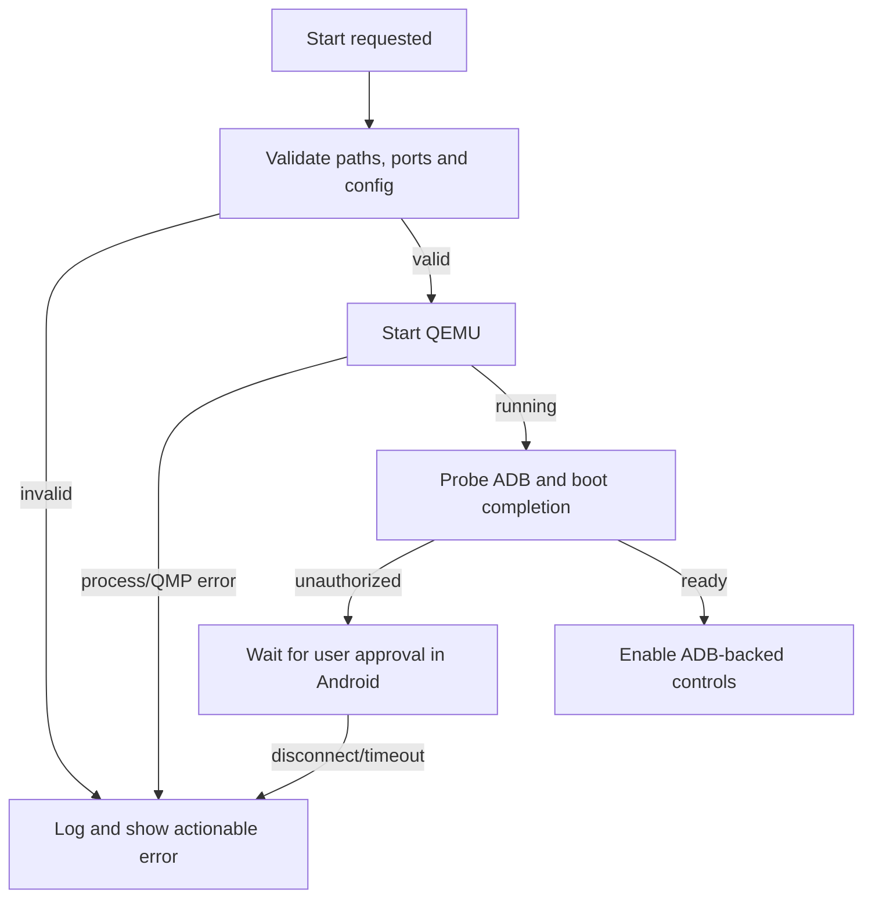
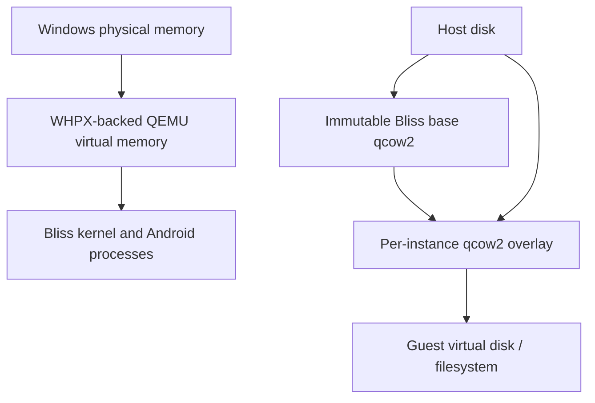
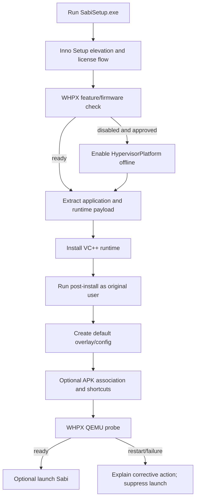
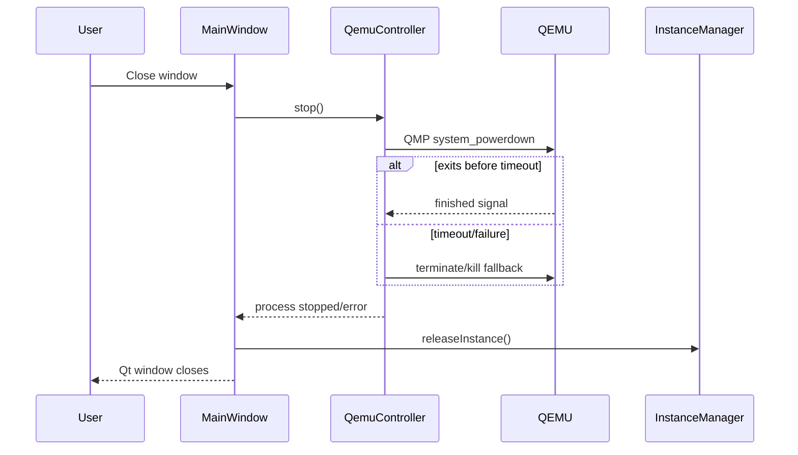
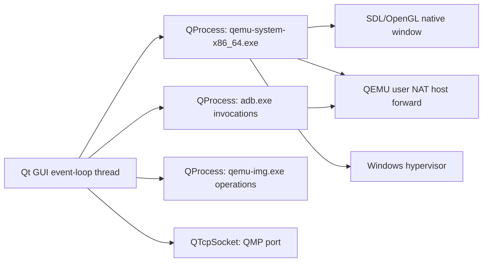

# Sabi: Native Windows Android Emulator
## Major Project Technical Report / Software Requirements and Implementation Documentation

**Version reviewed:** repository declares Sabi 2.0.0 (`host-app/CMakeLists.txt:3`)  
**Prepared:** 31 October 2026  
**Target platform:** Windows 10 version 1809+ / Windows 11, x64  
**Implementation language:** C++17 and PowerShell, with JSON, CMake and Inno Setup configuration  
**Project type:** native Windows host application that orchestrates an external Android-x86 virtual machine

> **Evidence convention.** *Verified* means directly evidenced by a tracked source, build, test, or recorded project document. *External-engine behavior* describes QEMU, WHPX, Bliss OS, ADB, Qt or Inno Setup and is not reimplemented by the project. *Inference* is explicitly labelled. Generated QEMU/ADB binaries, virtual disks and installer EXEs are excluded from Git; this report does not claim their contents were statically inspected.

## Contents

1. [Abstract](#1-abstract-and-keywords)
2. [Introduction, problem and objectives](#2-introduction-problem-and-objectives)
3. [Requirements specification](#3-software-requirements-specification)
4. [Technology stack and environment](#4-technology-stack-and-environment)
5. [Architecture and design](#5-architecture-and-design)
6. [Module implementation](#6-module-by-module-implementation)
7. [Emulator mechanisms](#7-emulator-fundamentals-and-hostguest-interaction)
8. [Installation, startup and execution trace](#8-installation-startup-and-execution-trace)
9. [Configuration, data and IPC](#9-configuration-data-and-process-architecture)
10. [Security, resilience and resource management](#10-security-error-handling-and-resource-management)
11. [Testing and results](#11-testing-results-and-performance-evidence)
12. [Limitations, future scope and conclusion](#12-limitations-future-scope-and-conclusion)
13. [User and developer guide](#13-installation-user-manual-and-developer-guide)
14. [References, glossary and appendices](#14-references-glossary-and-appendices)

## List of figures

1. Figure 1 — System architecture
2. Figure 2 — Component dependency graph
3. Figure 3 — Installer flow
4. Figure 4 — Runtime sequence
5. Figure 5 — Guest boot and control path
6. Figure 6 — Shutdown path

## List of tables

1. Table 1 — Functional requirements
2. Table 2 — Non-functional requirements
3. Table 3 — Technology stack
4. Table 4 — Module responsibilities
5. Table 5 — QEMU configuration concepts
6. Table 6 — Test evidence
7. Table 7 — Known limitations

## 1. Abstract and keywords

Sabi is a native Windows desktop application that provides a graphical host for an Android-x86 guest. It does not emulate x86 processors itself. Instead, its C++/Qt host process validates an instance configuration, launches a separate QEMU process with the Windows Hypervisor Platform (WHPX), embeds QEMU's SDL display into a Qt window, sends machine-control commands over QEMU Machine Protocol (QMP), and uses Android Debug Bridge (ADB) for Android-level actions. Each Android installation writes to a per-user qcow2 overlay backed by a shared read-only Bliss OS image. The design provides independent instances, configurable resources, APK installation, file transfer, keyboard mapping, navigation controls, logging, and an offline Inno Setup packaging path.

The strongest evidence supports compilation and focused automated tests. The project README records that ten registered CTest suites passed on 21 October 2026 and that installer staging hashes passed. It also explicitly records that clean-machine installation, fresh-device ADB authorization, and certain physical input/display acceptance checks remain outstanding. Those limitations are preserved here rather than converted into claims of completion.

**Keywords:** Android-x86, Bliss OS, QEMU, WHPX, Qt 6, QMP, ADB, qcow2, Inno Setup, Windows virtualization.

## 2. Introduction, problem and objectives

### 2.1 Background and problem statement

Running Android software on Windows commonly requires either a device, a cloud service, or a heavyweight emulator. This project addresses the local/offline use case: a Windows user should be able to boot an Android environment, interact with it in a desktop window, install APK files, retain guest state, and run more than one independent guest. The problem is split between host orchestration and virtual-machine execution. QEMU/WHPX executes the guest; the custom host supplies product behavior and integration.

### 2.2 Objectives, scope and contribution

The verified objectives are to:

- create and manage isolated Android instances using qcow2 overlays;
- launch QEMU with WHPX only, rather than HAXM or a silent software fallback;
- embed the guest display in a Qt desktop window;
- translate user input and configurable keymaps into guest input;
- expose Android-level controls and APK/file operations through ADB;
- package the host/runtime inputs for offline setup while checking WHPX;
- document notices, source offers, test boundaries, and known camera constraints.

Out of scope or explicitly incomplete features include Google Play/GApps, a shared-folder toolbar implementation, rotate implementation, GUI keymap editing, RAM snapshots, verified physical webcam pass-through, and a proven clean-PC release artifact. See Table 7.

### 2.3 Existing versus proposed system

The *existing underlying system* is QEMU plus a prepared Bliss OS qcow2 image, ordinarily launched by command line. The *proposed/custom system* is Sabi: a product wrapper with Qt UI, instance configuration, QMP control, ADB workflows, Windows integration and packaging. QEMU remains an independently distributed GPLv2 process; it is not compiled into `Sabi.exe`.

## 3. Software requirements specification

### 3.1 Functional requirements

| ID | Requirement | Implementation evidence | Status |
|---|---|---|---|
| FR-01 | Launch a configured Android VM with WHPX. | `QemuController::start`, `buildCommandLine`; `vm/configs/default-instance.json`. | Implemented, host-dependent. |
| FR-02 | Control VM status, pause/resume and stopped-disk snapshots. | `qemu_controller.cpp:193–261`; QMP client. | Implemented; snapshots are disk-only. |
| FR-03 | Render the guest in the application. | `DisplayEmbed::embedWindow` at `display_embed.cpp:101`. | Implemented with Win32 SetParent; requires physical acceptance. |
| FR-04 | Send pointer, keyboard and keymap actions. | `input_handler.cpp:306–719`, `keymap_engine.cpp`. | Implemented; latest physical pointer routing must be revalidated. |
| FR-05 | Install APKs by button, drag/drop, launch argument and file association. | `MainWindow`, `AdbBridge::installApk`, `sabi.iss` registry section. | Implemented after boot/ADB authorization. |
| FR-06 | Transfer ordinary files and request media scan. | `AdbBridge::pushFile` and `mediaScan`. | Implemented. |
| FR-07 | Manage instances: create, clone, reset, delete. | `instance_manager.cpp:388–517`; instance UI. | Implemented with stop/lock/validation rules. |
| FR-08 | Save per-instance CPU, RAM, display, ports and camera settings. | `SettingsDialog`, `InstanceManager::setConfig`. | Implemented; most changes require restart. |
| FR-09 | Build an offline installer. | `installer/sabi.iss`, bundle scripts and notices. | Script implemented; distribution acceptance incomplete. |

### 3.2 Non-functional requirements

| Area | Requirement / design response |
|---|---|
| Compatibility | x64 Windows 10 1809+ or Windows 11; MSVC 2022 target; Qt 6.5+ configured dynamically. |
| Isolation | Per-instance qcow2 overlays and distinct QMP/ADB ports; no shared writable guest disk. |
| Safety | Restricts instance names, validates configurations and ports, blocks destructive disk operations while running, prompts before reset/delete. |
| Observability | Qt message handler writes `%LOCALAPPDATA%\Sabi\Sabi\sabi-<pid>.log`; QEMU stdout/stderr are captured. |
| Offline installation | Setup contains runtime payloads and uses `-LimitAccess` when offering to enable WHPX. |
| Recoverability | User data is retained by default at uninstall; VM stop has graceful shutdown then timeout/kill path. |
| Licensing | Dynamic Qt; separate QEMU process; installer copies license/source-offer material. |

### 3.3 Hardware and software prerequisites

The README specifies Windows 10 1809+/Windows 11 x64, firmware-enabled Intel VT-x or AMD SVM, Windows Hypervisor Platform, OpenGL-capable SDL display support, practical 8 GB RAM and 15 GB free storage. Development additionally requires Visual Studio 2022 with C++ x64 tools, CMake 3.21+, Qt dynamic MSVC kit, QEMU with WHPX/SDL/OpenGL/qemu-img, Android platform-tools, a prepared Bliss image, and Inno Setup 6.x for packaging. These are prerequisites, not features supplied by C++ source alone.

## 4. Technology stack and environment

### 4.1 Complete stack

| Technology | Version evidence | Use / location | Dependency class and constraints |
|---|---|---|---|
| C++ | C++17 (`CMakeLists.txt:7`) | Host implementation. | Direct; MSVC 2022-compatible. |
| Qt Core, Network, Widgets, Gui | CMake requires 6.5; README records tested 6.12.0 | Event loop, widgets, JSON, processes, sockets, file I/O. | Direct/dynamic LGPL dependency; matching MSVC kit required. |
| CMake | ≥3.21 | Configure host and tests. | Direct build tool. |
| MSVC / Visual Studio | 2022 | x64 compilation and Windows SDK integration. | Toolchain. |
| QEMU | README records tested Windows ar7 11.1.0 build | External VM engine, QMP, qcow2 and SDL/OpenGL. | External GPLv2 executable; must support WHPX. |
| WHPX | Windows optional feature | Hardware virtualization acceleration. | System dependency; BIOS/UEFI and Windows feature must be enabled. |
| Bliss OS / Android-x86 | README records Bliss 14.10.3 | Guest OS in prepared qcow2 base. | External guest image. |
| ADB platform-tools | README records 37.0.1 | Guest provisioning, APK/file/nav/screenshot actions. | External executable + DLLs; guest must expose TCP 5555. |
| Inno Setup | README records 6.7.3 | Offline installer compilation. | Packaging-only tool. |
| PowerShell | Windows PowerShell | WHPX checks, staging, post-install/uninstall. | Host system dependency. |
| Linux/WSL utilities | image-build README | Optional image creation/provisioning only. | Development-only. |

### 4.2 Why these technologies fit

Qt supplies a native event loop, portable C++ APIs, child-process control and Windows widgets without implementing a web server. QEMU provides mature x86 virtual hardware and QMP; WHPX lets it use Windows’ hardware virtualization facility. qcow2 overlays make each instance writable without duplicating the base image. ADB is appropriate for Android services that occur after boot, such as package installation and `input keyevent`. Inno Setup is used to produce a traditional Windows installer and file association.

## 5. Architecture and design

### 5.1 High-level architecture



Figure 1 depicts process boundaries. `Sabi.exe`, `qemu-system-x86_64.exe`, and `adb.exe` are distinct processes. The hypervisor and Android kernel internals lie outside the custom repository.

### 5.2 Low-level component relationships



### 5.3 Data-flow design



### 5.4 Use cases and failure routing





### 5.5 Design decisions

The project selected SetParent embedding of QEMU SDL rather than a VNC client. This avoids adding a VNC server/client transport in the initial product design, but it introduces Windows focus, coordinate, DPI and child-window input risks. The recent input code contains both QMP absolute USB-tablet conversion and native child-window forwarding; this dual path warrants manual acceptance on target hardware.

## 6. Module-by-module implementation

### 6.1 Bootstrap, logging and launch handoff

`host-app/src/main.cpp:86` is the process entry point. It creates a Qt application, establishes file logging via a Qt message handler, parses `--instances`, `--instance`, an APK path, and `--initialize-only`, initializes `InstanceManager`, and either opens an instance list or `MainWindow`. `LaunchChannel` uses a local lock/channel arrangement to deliver later command-line requests to an existing process. Its test is registered as `launch_channel`.

Inputs are command-line arguments and local resource paths. Outputs are a GUI, persistent log file and potentially a forwarded launch request. Failures are logged and surfaced by Qt UI paths; exact launch-channel protocol behavior should be read in `host-app/src/launch_channel.cpp` before changing it.

### 6.2 Virtual-machine controller and QMP

`QemuController` (`include/qemu_controller.h`, `src/qemu_controller.cpp`) owns QEMU through `QProcess`. `start` at line 87 reads JSON then starts QEMU; `stop` requests a graceful `system_powerdown`, starts a shutdown timeout, and `kill` provides forced termination. `pause`, `resume`, and `queryStatus` send QMP commands. Its snapshot methods intentionally operate on a stopped disk using `qemu-img`, not on RAM or device state.

`readConfiguration` (line 521) validates required paths/configuration and resolves installed versus development resources. `buildCommandLine` (line 615) constructs command arguments. From documented configuration and architecture, relevant options include WHPX acceleration, memory and CPU count, qcow2 overlay, USB tablet input, user-mode NAT plus TCP port forward for ADB, QMP TCP server, and SDL/OpenGL/virtio display. The exact final command must be treated as configuration-dependent rather than assumed from this report.

`QmpClient` uses `QTcpSocket`; it waits for the QMP greeting, negotiates capabilities, serializes JSON request lines with IDs, tracks pending commands and emits responses/errors/timeouts. This is the VM-control IPC channel. It is not an HTTP service and the project does not create a localhost web app.

### 6.3 Display and input

`DisplayEmbed::embedWindow` (`display_embed.cpp:101`) receives a discovered Win32 QEMU SDL window handle. On Windows it alters/reparents that child using `SetParent`, keeps the native Qt widget opaque/black behind it, handles resize events and calculates aspect-preserving geometry. `focusEmbeddedWindow` reestablishes focus using Windows APIs. A deliberate black letterbox region is preferable to non-uniform scaling.

`InputHandler` installs an event filter in `installOn` and handles Qt mouse/key events at `input_handler.cpp:306`. It scales Qt coordinates to QMP absolute axes, maps buttons/keys, forwards keymap-generated actions and releases held input on focus loss. `forwardNativeMouseEvent` (line 375) posts Windows mouse messages to the embedded SDL child as the recent routing path. The source also provides controlled native-event dispatch helpers for fixture testing. A physical report of a cursor that cannot enter or control the display is therefore a current acceptance issue, not evidence to claim this feature is universally solved.

### 6.4 Keymap engine

`KeymapProfile` parses/serializes the documented JSON schema. `KeymapEngine` loads a profile, keeps pressed-key and timer state, scales from profile reference resolution to actual guest resolution and emits actions. The five implemented action types are `tap`, `hold`, `swipe`, `passthrough`, and `repeat_tap`; default and WASD sample profiles are in `host-app/resources/keymaps/`. This module delegates actual event transport to `InputHandler`/QMP.

### 6.5 ADB subsystem

`AdbBridge` starts at `connectToGuest` (`adb_bridge.cpp:86`) and uses `QProcess` for bounded asynchronous commands. The state sequence includes ADB server start, guest listener probe, `adb connect`, RSA authorization observation, transport validation, boot-completion polling and connection-health polling (`startAdbServer` line 472 through `handleDisconnected` line 777). This is designed to avoid endlessly connecting to a closed guest port.

Once `sys.boot_completed` is established, public operations execute `adb install`, `push`, media scan broadcast, `exec-out screencap`, Android key events, and arbitrary approved shell commands. The target serial is the per-instance forwarded TCP endpoint, so instance operations should not target a random USB Android device.

### 6.6 Instance management and settings

`InstanceManager::initialize` at line 320 finds application resources, migrates compatible legacy paths where applicable and ensures a default instance. `createOverlay` invokes the external `qemu-img` tool with the base image; `createInstance`, `cloneInstance`, `deleteInstance`, `factoryReset` and `setConfig` implement CRUD from lines 388–508. Validation restricts safe names, CPU (host core count, capped at eight), RAM (up to half host RAM and 8192 MB), port uniqueness, paths and running-state operations. In-memory locks prevent same-process conflicting disk use; the file/OS-level guarantees should not be overstated beyond tested behavior.

`SettingsDialog` edits CPU, memory, resolution, DPI, QMP/ADB ports and experimental USB-camera identifiers. `InstanceListWindow` exposes create/start/stop/clone/settings/delete/reset and executes long disk operations away from the immediate UI path. Changes to QEMU-shaped settings normally apply after restart; display/DPI can also be requested through ADB after Android boots.

### 6.7 Installer and image preparation

`installer/sabi.iss` is the authoritative installer script. `[Files]` copies application, QEMU, ADB, image, config, licenses, notices/source material, prerequisite script and post-install scripts. `[Registry]` supplies `.apk` Open With/optional association while avoiding per-user `UserChoice` modification. `[Run]` launches only when WHPX readiness allows it. `PrepareToInstall` checks WHPX and optionally enables the Windows feature; `CurStepChanged` installs the bundled VC++ runtime, calls the post-install default-overlay setup as the original user, and probes QEMU/WHPX. Uninstall asks whether to delete the current user’s data and restores the previous machine APK association when possible.

`installer/check_whpx.ps1` checks firmware virtualization and the `HypervisorPlatform` optional feature. `-Enable` uses `Enable-WindowsOptionalFeature -LimitAccess -NoRestart`; `-Probe` creates a short diskless, paused QEMU process with `-accel whpx` and expects a QMP greeting. Exit codes are 0 ready, 10 feature disabled, 11 restart required, 12 firmware disabled and 20 error. This is an evidence-based WHPX check; it cannot enable BIOS/UEFI virtualization.

The `image-build` scripts are not part of normal launch. They prepare a derivative image, provision ADB startup data and avoid overwriting an existing output. A redistributable base must not carry a developer’s ADB host authorization key.

## 7. Emulator fundamentals and host–guest interaction

### 7.1 CPU, memory, storage and graphics

QEMU is responsible for CPU virtualization and virtual hardware. WHPX asks Windows to supply hardware-assisted virtualization. Sabi passes configured vCPU and RAM choices; it does not map guest memory itself. The guest system is Bliss OS/Android-x86. Storage is a qcow2 overlay with a read-only base: guest writes allocate in the overlay, reducing duplicate base copies and isolating instances. A stopped overlay requires its exact backing base; copying only `overlay.qcow2` is not a sufficient backup.

The display is an external QEMU SDL/OpenGL window, reparented into Qt. The project’s host UI does not decode a video stream. Audio/network behavior is primarily external QEMU/guest behavior. Networking is documented as QEMU user-mode NAT; ADB works through a host TCP forward to guest port 5555. This report cannot verify application-level Internet access or audio quality without a live guest test.



### 7.2 Input and Android services

The input device design uses QEMU absolute tablet input, which is appropriate for host-to-guest pointer coordinate mapping. QMP events carry absolute axes and button/key transitions; the recent native path also addresses the SDL child directly. Keyboard profiles turn a host key into timed/scaled touch gestures. Android controls after boot use ADB `input keyevent`, rather than QMP.

### 7.3 Guest boot sequence

```mermaid
sequenceDiagram
  participant U as User
  participant S as Sabi
  participant Q as QEMU/WHPX
  participant B as Bliss OS
  participant A as adb.exe
  U->>S: Start instance
  S->>S: Read/validate config and acquire lock
  S->>Q: QProcess launch with overlay, QMP, SDL, NAT
  Q->>B: Start virtual machine and Android boot
  S->>Q: Connect QMP / query state
  S->>A: Start server, probe forwarded ADB port
  A->>B: TCP transport / optional RSA authorization
  A->>B: poll sys.boot_completed
  B-->>S: Android Ready through ADB state
  Q-->>S: SDL top-level window
  S->>S: Embed SDL window; enable ADB toolbar actions
```

## 8. Installation, startup and execution trace

### 8.1 Complete setup-to-runtime trace



**Step-by-step evidence:**

1. **Obtain and run setup.** `installer/sabi.iss:[Setup]` identifies a 64-bit, admin-required modern Inno Setup package. The repository does not include a public release inventory, so a source checkout alone does not prove an installer is available to download.
2. **Prerequisite evaluation.** `CurPageChanged` extracts `check_whpx.ps1` and invokes it. Firmware disabled, feature disabled, restart-needed and unknown states produce separate user messages.
3. **Payload extraction.** `[Files]` copies Qt host files, QEMU, ADB, a provisioned base, configs, notices/source material and license texts to `{app}`. This is the offline bundle design.
4. **Runtime and data initialization.** `CurStepChanged(ssPostInstall)` runs bundled `vc_redist.x64.exe`, then `post-install.ps1` as the original signed-in user. The latter creates default user data rather than forcing it into the elevated installer account’s profile.
5. **Registration.** Start Menu/Desktop shortcuts are created. The installer registers `Sabi.APK`; its optional association is designed not to overwrite Windows per-user UserChoice.
6. **First app launch.** `main.cpp:86` creates the Qt event loop/logging, chooses an instance/list, and `MainWindow::startVm` begins the window-local lifecycle.
7. **VM startup.** `QemuController::start` reads JSON, validates runtime paths and starts QEMU as a child process. QMP connects after QEMU initializes.
8. **Guest boot and display.** QEMU boots the external Bliss image. `MainWindow` periodically finds the QEMU display window and `DisplayEmbed` reparents it.
9. **Android service readiness.** ADB avoids assuming port readiness means Android readiness; it validates transport and boot completion before enabling dependent operations.
10. **Shutdown.** Closing the main window requests a graceful VM shutdown, waits for a bounded period, then offers/uses force termination according to controller/UI sequencing. `InstanceManager::releaseInstance` frees the application lock. Qt parent ownership disposes window-owned objects during teardown.

### 8.2 Files created or changed at runtime

- Instance config and overlay in the per-user instance directory.
- A content-hash-organized backing base in the user data root for installed builds.
- Host log files under LocalAppData.
- Inno Setup registry entries/shortcuts and, optionally, APK class association.
- Android-owned files inside the qcow2 overlay: settings, installed packages, downloads and app data.

### 8.3 Uninstall behavior

The uninstaller removes installed program resources. It deliberately asks whether the account running uninstall should remove Sabi user data; choosing No retains overlays and bases. It restores/deletes the machine APK association only when it remains Sabi’s association. A user must not assume data belonging to another Windows account will be removed.

### 8.4 Shutdown and cleanup sequence



## 9. Configuration, data and process architecture

### 9.1 Configuration parameters

| Parameter group | Examples | Consumer | Effect |
|---|---|---|---|
| Instance identity | name, directory | InstanceManager | Separates configuration/storage. |
| Compute | CPU cores, RAM MB | QemuController/QEMU | Applied at next guest start. |
| Display | width, height, DPI, profile | QEMU / MainWindow / ADB | Defines guest and host geometry; can persist per instance. |
| Control | QMP port, ADB host port | QMP/ADB bridge | Must not collide with another process/instance. |
| Storage | base image, overlay path | qemu-img/QEMU | Parent/child qcow2 relationship. |
| Camera | mode and USB IDs | settings/QEMU configuration | Experimental only. |

### 9.2 Process, thread and IPC map



The C++ code is event-driven: Qt signals, `QTimer`, `QTcpSocket` callbacks and `QProcess` callbacks prevent most control-plane tasks from blocking the UI. The repository does use an instance-list operation worker thread for potentially slow disk operations. QEMU owns guest execution scheduling, vCPU threads, guest memory mapping, rendering back end and guest packet processing; these are external-engine mechanisms, not custom host implementation.

## 10. Security, error handling and resource management

### 10.1 Security/threat analysis

| Boundary / threat | Current mitigation | Remaining concern |
|---|---|---|
| User-supplied instance name/path | Name/config validation and per-instance roots. | Review every path normalization before accepting untrusted UI input. |
| Malicious APK/guest app | Runs in guest disk/VM boundary. | Guest exploits, shared NAT access and QEMU vulnerabilities remain possible; keep QEMU updated. |
| Host/guest ADB | RSA authorization enabled; boot/transport state checked. | A user must inspect/approve unknown Android RSA prompts; exposed localhost ports need collision controls. |
| Firmware/feature privilege | Installer uses elevation only for Windows feature/runtime/registration. | BIOS/UEFI cannot be enabled by software; feature changes require restart. |
| Data deletion | Confirmation, stopped-instance checks and retained-by-default uninstall data. | Factory reset/delete are intentionally destructive after confirmation. |
| Third-party licensing | Separate QEMU, Qt dynamic linkage, bundled notices/source offer. | Redistribution still needs final source/notices review noted in README. |

No secrets, access tokens or private keys should be placed in configs, report examples or base images. In particular, an authorized developer ADB key must not be redistributed in the base disk.

### 10.2 Error handling and recovery

The documented coding convention uses `qWarning`, `qCritical`, `qInfo` and user-facing `QMessageBox` errors. `QemuController` translates startup/process/QMP failures into descriptive messages, captures standard output/error, times out QMP operations and emits error signals. `AdbBridge` gates boot-dependent actions and distinguishes authorization, connection and boot-status states. Installer failure messages tell the user whether to enable WHPX, restart Windows, enable firmware virtualization, check disk space, or inspect a LocalAppData log.

### 10.3 Actual optimizations and resource choices

Implemented optimizations include hardware acceleration through WHPX, shared read-only bases plus copy-on-write qcow2 overlays, bounded CPU/RAM selections, asynchronous Qt process/socket operations, and aspect-preserving display geometry. QMP avoids heavyweight guest control polling when commands/events suffice. These are design optimizations; no source provides CPU percentage, FPS, boot-time distribution, disk-I/O benchmark, or memory-leak profiling results. Any numerical performance claim would be unsupported.

Recommended measurement plan: record cold/warm boot time to `sys.boot_completed`, working-set/CPU for host and QEMU with Windows Performance Recorder, overlay growth after a standard workload, input-to-action latency with a reproducible app, and installation duration on a clean computer. Repeat across at least two hardware classes.

## 11. Testing, results and performance evidence

### 11.1 Automated test strategy

| Test / script | Objective | Recorded outcome | Evidence boundary |
|---|---|---|---|
| `installer_preflight` | Bundle, PowerShell syntax, notices and installer configuration checks. | Pass recorded in README. | Does not install product. |
| `whpx_script` | PowerShell WHPX-check behavior. | Registered. | Hardware/feature conditions vary. |
| `vm_control_config` | VM configuration loading. | Pass recorded. | Does not prove full Android boot. |
| `display_input` | Coordinate scaling and Qt/QMP translations. | Pass recorded. | Not a physical SDL mouse acceptance test. |
| `keymap` | JSON schema, scaling and five action types. | Pass recorded. | Does not prove every game’s behavior. |
| `adb` | Fake/fixture ADB connection, install, push, scan, screenshot/nav. | Pass recorded. | Does not replace live guest test. |
| `instance_manager` | Real temporary qcow2 CRUD/validation/ports/locks. | Pass recorded. | Requires compatible local QEMU tools. |
| `phase5_ui` | Offscreen settings/list widgets and confirmations. | Pass recorded. | Offscreen UI differs from interactive Windows. |
| `native_keyboard` | Native-window fixtures, focus isolation and host edit controls. | Pass recorded. | Tests keyboard fixture path, not every physical guest display condition. |
| `test_adb_live` | Opt-in live guest operation. | Not registered in CTest. | Must be explicitly executed and observed. |

The README’s explicit recorded result is **10/10 registered suites passed in 28.33 seconds on 21 October 2026**, with **3,399 staged SHA-256 paths passing**. This is historical project evidence, not a claim that tests were rerun during preparation of this static report. Recent mouse/display changes and any post-21-October build require a fresh build/test record.

### 11.2 Missing validation

Not-run or incomplete evidence includes a clean Windows installation, fresh Android RSA approval, full uninstall/reinstall data-retention A/B test, third-party source/notices review, webcam pass-through, physical mouse interaction over the current embedded SDL route, and quantified performance benchmarking. The repository documents these openly in README and Phase 6 testing material.

## 12. Limitations, future scope and conclusion

### 12.1 Known limitations

| Limitation | Impact | Recommended next action |
|---|---|---|
| Embedded-pointer defect | The earlier global hook suppressed cursor motion at the SDL boundary. | Fixed and physically rechecked with a touchpad on the development PC; validate on a clean-PC hardware matrix before public release. |
| Rotate and Shared Folder are toolbar stubs | User-visible incomplete controls. | Implement or hide/label clearly before a final release. |
| Camera experimental | No verified webcam support. | Maintain honest CAMERA.md; test supported QEMU capture back ends only on dedicated hardware. |
| Disk-only snapshots | No suspend/resume RAM state. | Document expectation or evaluate QEMU savevm design with compatible storage. |
| No GUI keymap editor | Requires JSON/API manipulation. | Add validated editor/profile selector. |
| Clean-PC installer not completed | Installation reliability across machines unknown. | Run V1 acceptance case file on an independent clean PC. |
| No performance benchmark dataset | No defensible performance comparison. | Execute the measurement plan in §10.3. |

### 12.2 Future scope

Prioritized future work: resolve physical display input and high-DPI alignment; finish non-stub toolbar actions; add guest resolution/profile UI acceptance tests; add durable, versioned configuration migrations; introduce explicit health diagnostics; develop a secure shared-folder model; create keymap management UI; and establish a signed/reproducible release pipeline with clean-machine CI/VM validation. Do not present any of these as already implemented.

### 12.3 Conclusion

Sabi has a coherent host-orchestrator architecture. It correctly delegates virtualization to QEMU/WHPX and Android operations to ADB while keeping custom policy, UI, configuration, lifecycle and packaging code in C++/Qt. The recorded automated coverage is meaningful for configuration, protocols, storage CRUD and UI fixtures. However, a production-ready claim must await fresh end-to-end acceptance of the exact build—especially embedded display input and a clean-machine installer run. The project is technically defensible when those boundaries are stated honestly.

## 13. Installation, user manual and developer guide

### 13.1 End-user installation

1. Confirm x64 Windows 10 1809+ or Windows 11, firmware virtualization and sufficient storage.
2. Run the verified `SabiSetup.exe` obtained from a trusted release source.
3. Accept the license. If prompted, permit Windows Hypervisor Platform enablement, then restart Windows when required.
4. Let setup install the VC++ runtime and initialize the current user’s default overlay.
5. Launch Sabi from Start Menu/Desktop. Wait for Android Home and approve Android’s ADB/RSA prompt only if it belongs to this host.
6. Wait for status **Ready** before using ADB-backed toolbar operations, APK install or file push.
7. Use **Instances** to create/configure independent guests. Stop an instance before clone/reset/delete.

### 13.2 Common user troubleshooting

- **WHPX not ready:** run elevated `installer/check_whpx.ps1 -Probe -QemuPath <path-to-qemu-system-x86_64.exe>`, enable `HypervisorPlatform`, restart, and verify BIOS/UEFI virtualization.
- **ADB unauthorized:** allow the Android RSA debugging dialog, then wait for the status state to update; do not repeatedly start unrelated `adb connect` loops.
- **No boot / QEMU failure:** inspect `%LOCALAPPDATA%\Sabi\Sabi\sabi-<pid>.log`, confirm base/overlay remain present and no port conflict exists.
- **Input/display mismatch:** record application version, display scaling, host resolution, instance guest resolution and precise pointer offset; this is a known acceptance-sensitive area.
- **Storage concern:** do not delete a base image referenced by an overlay. Back up stopped overlays *with* their backing bases.

### 13.3 Developer build and test guide

From repository root, place untracked QEMU, ADB and prepared image assets in the documented `vm/` locations. Then run:

```powershell
cmake -B cmake-build-dev -S host-app -G "Visual Studio 17 2022" -A x64 -DCMAKE_PREFIX_PATH="C:/Qt/6.12.0/msvc2022_64" -DBUILD_TESTING=ON
cmake --build cmake-build-dev --config Release
$env:PATH = "C:\Qt\6.12.0\msvc2022_64\bin;$env:PATH"
$env:QT_QPA_PLATFORM_PLUGIN_PATH = "C:\Qt\6.12.0\msvc2022_64\plugins"
ctest --test-dir cmake-build-dev -C Release --output-on-failure
```

Run the explicit live ADB harness only when a disposable authorized guest is intended. Build installer inputs using `installer/scripts/prepare-bundle.ps1`, validate staging with `tests/test_installer.ps1`, then run `installer/scripts/build-installer.ps1`; consult `installer/BUILD.md` for pinned inputs and legal redistribution obligations.

## 14. References, glossary and appendices

### 14.1 References

1. Project source: `host-app/CMakeLists.txt`; `host-app/src/*.cpp`; `host-app/include/*.h`.
2. Project architecture: `docs/ARCHITECTURE.md`.
3. User/developer/validation record: `README.md`, `docs/PHASE-4-AUDIT.md`, `docs/PHASE-5-TESTING.md`, `docs/PHASE-6-TESTING.md`.
4. Installation implementation: `installer/sabi.iss`, `installer/check_whpx.ps1`, `installer/BUILD.md`.
5. QEMU documentation: [QEMU documentation](https://www.qemu.org/docs/master/).
6. Qt documentation: [Qt 6 documentation](https://doc.qt.io/qt-6/).
7. Android Debug Bridge: [Android developer documentation](https://developer.android.com/tools/adb).
8. Windows Hypervisor Platform: [Microsoft virtualization documentation](https://learn.microsoft.com/windows/virtualization/).
9. Inno Setup help: [Inno Setup documentation](https://jrsoftware.org/ishelp/).

### 14.2 Glossary and abbreviations

| Term | Meaning |
|---|---|
| ADB | Android Debug Bridge, host-to-Android command tool/protocol. |
| API | Application Programming Interface. |
| COW | Copy-on-write storage behavior used by qcow2 overlays. |
| DPI | Dots per inch; logical display density. |
| IPC | Inter-process communication. |
| QMP | QEMU Machine Protocol, JSON-based control protocol. |
| qcow2 | QEMU copy-on-write disk image format. |
| SDL | Simple DirectMedia Layer; QEMU display front-end used here. |
| VM | Virtual machine. |
| WHPX | Windows Hypervisor Platform. |

### 14.3 Appendix A — repository inventory

See the separately maintained [repository map](EMULATOR_REPOSITORY_MAP.md) for the complete tracked architectural inventory, entry points, dependency graph, storage locations and test files. It is intentionally separated so that the report remains readable while file paths remain auditable.

### 14.4 Appendix B — evidence and report gaps

This report does not reverse engineer QEMU, Android/Bliss, Windows drivers, generated disk images, compiled Qt libraries or installer binaries. It does not expose private system paths, credentials or host keys. Claims about those components are limited to project configuration, external vendor documentation and recorded project evidence. A final submission should append an exact commit hash, build log, CTest XML/output, WHPX probe output, installer SHA-256, and completed clean-PC acceptance result for the release build being assessed.
