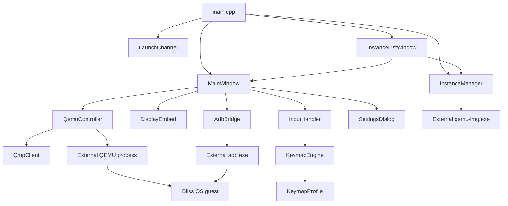

# Sabi repository map

**Analysis scope:** static review of the tracked repository on 26 October 2026. Generated artifacts, QEMU binaries, Android disk images, downloaded archives, and installer output are intentionally excluded from Git and were not executed for this review.

## Top-level layout

```text
AGENTS.md                         project workflow and build rules
README.md                         user/developer overview and recorded validation state
CHANGELOG.md                      release history
host-app/                         native Qt host application
  CMakeLists.txt                  C++17/Qt build; defines Sabi and sabi_core
  include/                        public C++ module interfaces
  src/                            application implementation and entry point
  resources/keymaps/              JSON keyboard-mapping profiles
vm/
  configs/default-instance.json   template QEMU/guest configuration
  scripts/check-whpx.ps1          development WHPX compatibility check
image-build/                      Linux/WSL scripts which prepare an ADB-ready base image
installer/
  sabi.iss                        Inno Setup installer definition
  check_whpx.ps1                  installer-side WHPX check/optional enablement
  scripts/                        bundle, post-install, and uninstaller helpers
  licenses/                       redistribution notices and source offer
  source-lock.json                pinned installer input metadata
tests/                            CTest test programs and PowerShell preflight tests
docs/                             architecture, phase guides, audit and acceptance evidence
```

## Entry points and deployment chain

| Stage | File / executable | Responsibility |
|---|---|---|
| Build entry | `host-app/CMakeLists.txt` | Requires CMake 3.21, C++17 and Qt Core/Network/Widgets/Gui; creates `sabi_core` and `Sabi.exe`. |
| Application entry | `host-app/src/main.cpp:86` | Sets Qt application metadata and file logging, parses launch arguments, initializes instance management and starts GUI windows. |
| Installer entry | `installer/sabi.iss` | Compiled by Inno Setup into `SabiSetup.exe`; deploys bundled runtime files, runs prerequisite checks and initializes default per-user data. |
| VM engine | `qemu-system-x86_64.exe` (external, bundled) | Runs Bliss OS with WHPX. It is launched by `QemuController`, not linked into Sabi. |
| Guest control | `adb.exe` (external, bundled) | Is spawned through `QProcess` by `AdbBridge` and reaches Android through QEMU TCP forwarding. |

## Module dependency map



## Major modules

| Module | Source | Purpose and principal dependencies |
|---|---|---|
| GUI bootstrap | `src/main.cpp` | Qt application, log file handler, CLI routing, single-instance launch channel. |
| Main emulator window | `src/main_window.cpp`, `include/main_window.h` | Creates toolbar, starts/owns VM display, wires ADB actions, accepts drops, fullscreen and close sequencing. |
| VM lifecycle | `src/qemu_controller.cpp`, `include/qemu_controller.h` | Validates JSON, builds QEMU arguments, owns `QProcess`, performs QMP commands and disk snapshot subprocesses. |
| QMP transport | `src/qmp_client.cpp`, `include/qmp_client.h` | `QTcpSocket` JSON-lines protocol, greeting/capability handling, request IDs, timeout/reconnect. |
| Display embedding | `src/display_embed.cpp`, `include/display_embed.h` | Windows-only SDL QEMU top-level-window discovery result is reparented using `SetParent`; aspect-preserving resize and focus. |
| Input | `src/input_handler.cpp`, `include/input_handler.h` | Qt event filter, Win32 forwarding to embedded child, QMP absolute USB-tablet and keyboard events, keymap integration. |
| Keymaps | `src/keymap_engine.cpp`, `src/keymap_profile.cpp` | Parses JSON profiles and emits tap/hold/swipe/passthrough/repeat-tap actions at scaled guest coordinates. |
| Android bridge | `src/adb_bridge.cpp`, `include/adb_bridge.h` | Bounded asynchronous ADB lifecycle, authorization/boot polling, install/push/media scan/screenshot/navigation. |
| Instance storage | `src/instance_manager.cpp`, `include/instance_manager.h` | Per-user config/data roots, config validation, ports, locks, overlay create/clone/delete/reset through qemu-img. |
| Settings and instance UI | `src/settings_dialog.cpp`, `src/instance_list_window.cpp` | Per-instance options and CRUD user interfaces. |
| Launch coordination | `src/launch_channel.cpp` | Local named channel/lock to deliver an APK or instance request to an already-running host. |

## Persistent data and configuration

| Item | Development location | Installed location / behavior |
|---|---|---|
| Default config template | `vm/configs/default-instance.json` | Installed under `{app}\vm\configs`; used to initialize a user instance. |
| Instance configuration | `instances/<name>/config.json` | `%LOCALAPPDATA%\Sabi\Sabi\instances\<name>\config.json`. |
| Writable Android disk | `instances/<name>/overlay.qcow2` | Per-user qcow2 overlay; backing base is retained under `%LOCALAPPDATA%\Sabi\Sabi\bases\<hash>`. |
| Host logs | N/A | `%LOCALAPPDATA%\Sabi\Sabi\sabi-<pid>.log`. |
| Keymaps | `host-app/resources/keymaps/*.json` | Copied adjacent to application runtime resources. |

## Test inventory

`tests/CMakeLists.txt` registers the installer preflight, WHPX-script, VM configuration, display/input, keymap, ADB fixture, instance-manager, Phase 5 UI, and native keyboard suites. `test_adb_live` is built but deliberately not registered because it targets a real Android guest. The Version 2 release-candidate record states that 10/10 registered suites passed on 31 October 2026. The embedded touchpad cursor fix was also physically checked on the development PC; clean-PC/display-scale acceptance remains pending.

