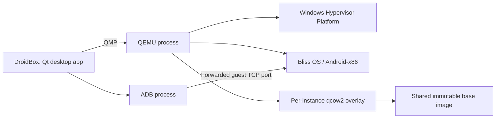

# DroidBox

**A native Windows desktop Android emulator built with C++17, Qt 6, QEMU, and WHPX.**

DroidBox runs Bliss OS (Android-x86) inside QEMU, embeds its display in a Qt
desktop window, and provides keyboard mapping, Android controls, APK installation,
and multiple independent instances. Its offline installer bundles the host and
runtime dependencies into one `DroidBoxSetup.exe`.

## Current status

Verification recorded on **21 October 2026**:

- Release application and test targets build with MSVC 2022 and Qt 6.12.0.
- All **10 registered CTest suites pass**, with zero failures.
- Installer preflight verified **3,397 staged file paths and SHA-256 hashes**.
- Local Inno Setup output is **319,804,420 bytes**; SHA-256 and test scope are
  recorded in [Phase 6 test results](docs/PHASE-6-TESTING.md).
- On this PC, a silent install to a path containing spaces booted Bliss to
  Android Home; live ADB APK, file transfer, screenshot, and navigation checks passed.
- Previous live checks verified Android boot, ADB authorization, multiple guests,
  and keyboard input isolation. See the acceptance records linked below.

**Still pending:** clean-machine offline installation, upgrade/data-retention
acceptance, and the complete third-party source/notices review for public
distribution. The local installer acceptance copy was removed after testing;
automated test results do not complete those checks.
Webcam passthrough remains experimental and unverified; a test-pattern camera
is unavailable in the bundled QEMU build.

This repository contains source and packaging instructions. Runtime binaries,
virtual disks, downloaded archives, and generated installers are excluded from
Git. The local build record is **not a public installer download**.

See [Phase 6 test results](docs/PHASE-6-TESTING.md) for the exact installer hash,
test scope, and remaining acceptance checklist.

## Contents

- [Features](#features)
- [Architecture](#architecture)
- [Requirements](#requirements)
- [Build from source](#build-from-source)
- [Use DroidBox](#use-droidbox)
- [Instances, settings, and data](#instances-settings-and-data)
- [Keyboard mapping](#keyboard-mapping)
- [Run tests](#run-tests)
- [Build the offline installer](#build-the-offline-installer)
- [Troubleshooting](#troubleshooting)
- [Repository layout](#repository-layout)
- [Development phases and documentation](#development-phases-and-documentation)
- [Contributing](#contributing)
- [Licenses and redistribution](#licenses-and-redistribution)

## Features

| Area | Implemented behavior |
|---|---|
| VM control | QEMU lifecycle, QMP status, pause/resume, and stopped-VM disk snapshots through the controller and CLI harness. |
| Acceleration | Windows Hypervisor Platform (WHPX). |
| Embedded display | Win32 `SetParent` embeds QEMU's SDL/OpenGL display in the Qt window. |
| Input | Mouse input and focused keyboard forwarding; keyboard routing also works with keymaps disabled. |
| Keymaps | JSON profiles, coordinate scaling, and `tap`, `hold`, `swipe`, `passthrough`, and `repeat_tap` actions. |
| Android controls | Home, Back, Recents, volume, Power, screenshot capture, and Fullscreen. |
| APK installation | Drag and drop, Install APK button, APK arguments, and installer-provided Windows file association. |
| File transfer | Drop a non-APK file to copy it into `/sdcard/Download/` and request a media scan. |
| Instances | Create, start, stop, clone, delete, and factory reset; independent qcow2 overlays and QMP/ADB ports. |
| Settings | Per-instance CPU, RAM, resolution, DPI, ports, and experimental USB webcam identifiers. |
| Packaging | Single offline Inno Setup EXE with Qt, QEMU, ADB, clean Android base, Microsoft runtime, licenses, notices, and collected sources. |

### Known feature limits

- **Rotate** and **Shared Folder** toolbar actions currently log a message; they
  are stubs. Drag-and-drop file transfer is implemented separately.
- There is no graphical keymap profile editor or profile-selection dialog.
  Profiles are supported by the engine and `InputHandler` API.
- Profile `mousemap` aim settings are metadata for future pointer behavior;
  they do not implement a working mouse-look mode.
- Snapshots preserve **disk contents only**, require a stopped VM, and do not
  preserve guest RAM/device state. There is no snapshot toolbar UI.
- Camera defaults to None. USB webcam passthrough is unverified and may require
  a host driver change. No virtual/test-pattern camera device is available.
  See [camera evaluation](docs/CAMERA.md).
- WHPX is the supported accelerator. HAXM and software-acceleration fallback are
  not part of the implementation.

## Architecture



Qt is linked dynamically. QEMU and ADB run as separate executables. Input goes
to the focused guest, and ADB commands target that instance's configured serial.
Writable Android changes go into its overlay.

See [docs/ARCHITECTURE.md](docs/ARCHITECTURE.md) for module responsibilities and
design decisions.

## Requirements

### Windows host

- Windows 10 **1809 or later**, or Windows 11, on an x64 system, matching the
  [validated Qt 6.12 Windows target](https://doc.qt.io/qt-6.12/windows.html).
- Intel VT-x or AMD-V/SVM enabled in BIOS/UEFI.
- Windows **Hypervisor Platform** enabled and usable by QEMU.
- Graphics support for the SDL/OpenGL and `virtio-vga-gl` display path.
- A practical starting point is **8 GB RAM** and **15 GB free disk space**.
  Additional guests, growing overlays, retained bases, and packaging need more.

The default config requests one CPU, 4096 MB RAM, and a 1080x1920 display at
240 DPI. Installed fresh-instance RAM defaults are limited by host memory.

### Development tools

| Tool/component | Requirement or verified input |
|---|---|
| Visual Studio | Visual Studio 2022, MSVC C++ x64 tools, and a Windows SDK. |
| CMake | 3.21 or newer. |
| Git | Cloning and installer source collection. |
| Qt | Dynamic Qt 6; CMake requires 6.5+. Verified kit: `C:/Qt/6.12.0/msvc2022_64`. |
| QEMU | Windows build with WHPX, SDL/OpenGL, `virtio-vga-gl`, `qemu-img`, DLLs, and firmware. Tests also use `qemu-io`. |
| ADB | Android platform-tools with both Windows DLLs. Verified package: 37.0.1. |
| Android image | Prepared Bliss OS qcow2 base. Verified guest: Bliss OS 14.10.3. |
| Inno Setup | Packaging only; verified compiler: 6.7.3. |
| Linux/WSL tools | Image preparation only; see [image-build instructions](image-build/README.md). |

The verified QEMU is the Windows ar7 fork reporting
`11.1.0 (v11.1.0-12130-ge470268ff4)`. Installer versions and hashes are pinned in
[installer/source-lock.json](installer/source-lock.json). These are the tested
inputs; arbitrary replacement builds have not been verified.

### Check WHPX

From the repository root, run in **elevated PowerShell** after placing QEMU in
`vm/qemu/`:

```powershell
powershell -NoProfile -ExecutionPolicy Bypass -File installer/check_whpx.ps1 -Probe -QemuPath "$PWD/vm/qemu/qemu-system-x86_64.exe"
```

Expected: JSON status `Ready`, `probePassed=true`, and exit code `0`. The probe
starts a diskless paused QEMU process and closes that process afterwards.

If the Windows feature is disabled, enable it in elevated PowerShell, then
restart Windows before starting Android:

```powershell
Get-WindowsOptionalFeature -Online -FeatureName HypervisorPlatform
Enable-WindowsOptionalFeature -Online -FeatureName HypervisorPlatform -All -NoRestart -LimitAccess
```

`-LimitAccess` keeps enablement offline. Missing local Windows component files
produce an error. BIOS/UEFI virtualization must be enabled in firmware; the
installer cannot switch it on in software.

## Build from source

Use **Windows PowerShell** for these examples. Adjust the Qt path to your installed
MSVC x64 kit. A source checkout can compile, but starting Android requires the
runtime files and disk image described below.

### 1. Clone

```powershell
git clone https://github.com/HEARTLESS5413/EMULATOR- droidbox
cd droidbox
```

### 2. Supply local runtime inputs

These large/generated inputs are ignored by Git:

```text
vm/
  qemu/
    qemu-system-x86_64.exe
    qemu-img.exe
    qemu-io.exe                 # Used by disk regression tests
    *.dll
    share/                     # Firmware and supporting files
    lib/                       # Include when supplied by the QEMU package
  adb/
    adb.exe
    AdbWinApi.dll
    AdbWinUsbApi.dll
    NOTICE.txt
    source.properties
  images/
    bliss-provisioned.qcow2     # Prepared base for fresh development instances
```

Keep the original `bliss-base.qcow2` when preparing a repaired base or retaining
older overlays that reference it. The original base predates the ADB startup
repair; fresh instances use `bliss-provisioned.qcow2`.

If preparing a base yourself, follow [image-build/README.md](image-build/README.md)
and [Phase 5 preparation](docs/PHASE-5-TESTING.md). With the documented Linux/WSL
tools and mounting support installed, the helper creates a detached output and
refuses to overwrite an existing output file:

```powershell
wsl -u root --exec sh image-build/prepare-instance-base.sh vm/images/bliss-base.qcow2 vm/images/bliss-provisioned.qcow2
```

This example supplies no host authorization key. Approve the host in Android's
RSA debugging dialog after boot. Preserve every backing base still referenced
by existing overlays.

### 3. Configure and compile

```powershell
cmake -B cmake-build-dev -S host-app -G "Visual Studio 17 2022" -A x64 -DCMAKE_PREFIX_PATH="C:/Qt/6.12.0/msvc2022_64" -DBUILD_TESTING=ON
cmake --build cmake-build-dev --config Release
```

Close an executable before rebuilding its output directory. A separate build
directory allows an existing development session to keep running.

### 4. Launch

Make the matching Qt DLLs and plugins available to this PowerShell process, then
launch from the repository root:

```powershell
$env:PATH = "C:\Qt\6.12.0\msvc2022_64\bin;$env:PATH"
$env:QT_QPA_PLATFORM_PLUGIN_PATH = "C:\Qt\6.12.0\msvc2022_64\plugins"
.\cmake-build-dev\Release\DroidBox.exe --instances
```

The first launch initializes default-instance data if needed. Without
`--instances`, one configured instance launches directly; multiple instances
open the list.

## Use DroidBox

### First boot and authorization

1. Start an instance and wait for Android to reach its launcher.
2. Select **Allow** if Android shows a USB debugging/RSA prompt for this host.
3. Wait for DroidBox's status bar to show **Ready**. Navigation, APK installation,
   and screenshot actions depend on ADB readiness.

The clean image keeps ADB authentication enabled and contains no personal host
key. While approval is pending, DroidBox observes the existing transport instead
of repeatedly connecting and disconnecting it.

### Install apps and transfer files

- **Install APK button:** choose an APK file.
- **Drag and drop:** drop an APK onto the emulator window to install it.
- **Command line:** pass an APK path; installation waits until Android is ready.
- **Windows association:** the installer registers Open With support and offers
  an APK association task. Existing Windows per-user choices remain respected.
- **Other files:** drop them onto the window to push them to
  `/sdcard/Download/` and request a media scan.

The tested FOSS guest contains **Neo Store**, an F-Droid repository client.
Proprietary Google Play/GApps are not part of DroidBox's packaging.

### Launch arguments

Use an existing instance name in the `--instance` examples below.

```powershell
# Open the instance list
.\cmake-build-dev\Release\DroidBox.exe --instances

# Start a named instance
.\cmake-build-dev\Release\DroidBox.exe --instance gaming

# Queue an APK for default
.\cmake-build-dev\Release\DroidBox.exe "C:\Apps\Example App.apk"

# Select an instance and queue an APK
.\cmake-build-dev\Release\DroidBox.exe --instance gaming "C:\Apps\Example App.apk"
```

The installer also uses `--initialize-only`: initialize default-instance data
without opening a GUI or booting a VM.

## Instances, settings, and data

Use the **Instances** toolbar action or `--instances` to open the manager.

| Operation | Behavior |
|---|---|
| Create | Creates a small qcow2 overlay and separate JSON config. |
| Start / Stop | Starts a guest or requests shutdown from its owning window. |
| Clone | Copies a stopped overlay, preserves guest data/internal snapshots, and allocates independent ports. |
| Settings | Saves CPU, RAM, display/DPI, ports, and camera options. |
| Factory reset | With confirmation, replaces a stopped instance's disk with a fresh overlay, erasing its apps/data. |
| Delete | With confirmation, removes the stopped instance and its data. |

Clone, reset, and deletion are blocked while a disk is in use. QMP/ADB ports are
checked against other instances and external listeners. Running-instance port
changes are rejected.

CPU settings are limited to host cores, capped at 8. RAM is limited to half host
memory, capped at 8192 MB, in 512 MB steps with a 1024 MB minimum. CPU/RAM/display
changes apply after restart; Android resolution/DPI are also applied through ADB
after boot.

### Storage locations

| Data | Development checkout | Installed application |
|---|---|---|
| Instance config | `instances/<name>/config.json` | `%LOCALAPPDATA%\DroidBox\DroidBox\instances\<name>\config.json` |
| Writable disk | `instances/<name>/overlay.qcow2` | The same per-user instance directory. |
| Backing base | `vm/images/`, as referenced by the overlay. | `%LOCALAPPDATA%\DroidBox\DroidBox\bases\<SHA-256>\bliss-provisioned.qcow2` |
| Host logs | `%LOCALAPPDATA%\DroidBox\DroidBox\droidbox-<pid>.log` | The same per-user logging location. |

The installed application normally lives in `C:\Program Files\DroidBox`.
Default-instance preparation runs as the original signed-in user. A verified
base copy is retained in that user's data directory so overlays keep their backing
image after uninstall. Different Windows accounts have separate data.

**Back up stopped instances together with their backing bases.** An overlay alone
is not a standalone disk. Do not overwrite or remove a base referenced by any
instance. Uninstall defaults to retaining user data; explicit deletion applies
only to the account running the uninstaller.

## Keyboard mapping

The host loads `resources/keymaps/default.json` beside the executable. Source
profiles live in [host-app/resources/keymaps](host-app/resources/keymaps):

- [default.json](host-app/resources/keymaps/default.json): basic passthrough bindings.
- [wasd-gaming.json](host-app/resources/keymaps/wasd-gaming.json): sample movement/action bindings.

Coordinates use the profile's reference resolution. The engine scales them to
the guest size, then `InputHandler` forwards touch/key events over QMP. Ordinary
keyboard input goes to the focused guest independently of keymap enablement.

Example tap profile:

```json
{
  "name": "Example",
  "version": 1,
  "resolution": { "width": 1080, "height": 1920 },
  "bindings": [
    { "key": "Space", "action": "tap", "params": { "x": 900, "y": 1600 } }
  ]
}
```

To customize the automatically loaded profile, edit the deployed `default.json`
and restart. Keep a backup: builds/deployment copy bundled profiles again.
Other profiles can be loaded through `InputHandler::loadKeymapProfile`; the WASD
sample is not selected automatically. See the [Phase 3 schema](docs/phase-guides/phase-3-keymap-engine.md).

## Run tests

After the full Release build, use a Windows desktop session with the runtime
inputs above available:

```powershell
$env:PATH = "C:\Qt\6.12.0\msvc2022_64\bin;$env:PATH"
$env:QT_QPA_PLATFORM_PLUGIN_PATH = "C:\Qt\6.12.0\msvc2022_64\plugins"
ctest --test-dir cmake-build-dev -C Release --output-on-failure
```

| Registered suite | Scope |
|---|---|
| `installer_preflight` | Packaging files, PowerShell syntax, license texts, and installer configuration. |
| `vm_control_config` | Phase 1 configuration loading. |
| `display_input` | Pointer scaling and Qt-to-QMP keyboard translation. |
| `keymap` | Profile parsing, scaling, and all five action types. |
| `adb` | ADB fixture: connection, install, push, media scan, screenshot, and navigation. |
| `instance_manager` | Temporary real qcow2 CRUD, data preservation, snapshots, reset, validation, ports, and locks. |
| `phase5_ui` | Offscreen settings/launcher widgets and confirmed/canceled disk operations. |
| `native_keyboard` | Foreign native-window fixtures, focus isolation, key releases, and host edit controls. |

Instance tests use temporary disks and bundled QEMU tools. `phase5_ui` also
requires the prepared development base. `native_keyboard` briefly opens fixture
windows and requires an interactive Windows desktop.

After staging the installer, verify every staged file separately:

```powershell
powershell -NoProfile -ExecutionPolicy Bypass -File tests/test_installer.ps1 -BundlePath "$PWD/installer/bundle"
```

**Recorded result:** 8/8 suites passed in 21.20 seconds on 21 October 2026; all
3,397 staged hashes also passed. CTest does not install the product or validate
every physical device, guest interaction, or Windows installer flow.

Live ADB tests are explicit opt-ins, excluded from CTest, and can install an APK
into a guest. See [tests/README.md](tests/README.md) for commands and the
[Phase 6 checklist](docs/PHASE-6-TESTING.md) for manual acceptance.

## Build the offline installer

See [installer/BUILD.md](installer/BUILD.md) for the complete input list, overrides,
source review, and installed behavior. Collect these inputs first:

- Inno Setup 6.x and Qt's `windeployqt`.
- QEMU, ADB, the signed offline Microsoft runtime, and pinned source archives.
- The clean, key-free `vm/images/bliss-distribution-v2.qcow2` image.

A development base that authorizes this PC's ADB key must not be redistributed
as a generic base. Use the clean distribution image and matching pinned hashes.

From the repository root, after building `cmake-build-dev/Release`:

```powershell
powershell -NoProfile -ExecutionPolicy Bypass -File installer/scripts/prepare-bundle.ps1 -AppDirectory "$PWD/cmake-build-dev/Release" -QtRoot "C:/Qt/6.12.0/msvc2022_64"
powershell -NoProfile -ExecutionPolicy Bypass -File installer/scripts/build-installer.ps1
```

Output: **`installer/Output/DroidBoxSetup.exe`**. The recorded 1.81 GB build took
approximately 29 minutes to compile. The wrapper prints its size and SHA-256.
Generated bundle/output directories stay local.

The package contains the host, Qt DLLs/plugins, QEMU and firmware, ADB, the clean
base, config/keymaps, Microsoft runtime, licenses, notices, and collected sources.
It uses no external `.bin` payload or installation-time dependency download.

Installer behavior includes:

1. Firmware/WHPX detection and an offer to enable the Windows feature offline.
2. Runtime installation and original-user default overlay initialization.
3. Start Menu and optional Desktop shortcuts.
4. APK Open With registration and optional machine association, preserving
   existing Windows per-user choices.
5. Launch suppression when acceleration is not ready or a restart is needed.
6. An uninstall choice to retain or delete the current account's instance data.

Full install/uninstall, offline clean-machine, and elevated WHPX acceptance remain
pending. Default builds record `releaseReady=false`. Public distribution requires
the complete corresponding-source/notices inventory and reviewed
`-ForDistribution` workflow in [installer/BUILD.md](installer/BUILD.md).

## Troubleshooting

| Symptom | What to check |
|---|---|
| Missing Qt DLL or platform plugin | Set the matching Qt `bin` and plugin paths above, or use `windeployqt`. Keep the MSVC x64 kit consistent. |
| WHPX cannot initialize | Run the elevated diskless probe; check BIOS VT-x/SVM, the Windows feature, and pending restart state. |
| WHPX testing inside another VM fails | The outer hypervisor must expose usable nested virtualization. |
| Bliss stalls at the boot splash | Check the tested QEMU build, `virtio-vga-gl`, and SDL OpenGL support. See the image guide. |
| Missing prepared base | Supply `vm/images/bliss-provisioned.qcow2`; the original base lacks the ADB startup repair. |
| ADB is unauthorized | Select Allow in Android's RSA prompt; inspect the status bar and host log. |
| ADB is offline/unavailable | Inspect guest boot, forwarded ports, `adbd`, and its TCP listener before retrying. Do not loop on `adb connect`. |
| Port conflict | Stop the owning instance/process or choose unused ports in Settings. |
| Clone/reset/delete refused | Close the VM and external disk writers; active disks are protected by locks. |
| Camera preview fails | Camera None is the supported default; USB passthrough is unverified and no synthetic camera is available. |
| Staging rejects an input | Compare hashes/versions with `installer/source-lock.json` and use the clean distribution image. |

For an authorized guest on the default host port, useful read-only diagnostics are:

```powershell
.\vm\adb\adb.exe devices -l
.\vm\adb\adb.exe -s localhost:5555 get-state
.\vm\adb\adb.exe -s localhost:5555 shell getprop sys.boot_completed
.\vm\adb\adb.exe -s localhost:5555 shell wm size
.\vm\adb\adb.exe -s localhost:5555 shell wm density
Get-Content "$env:LOCALAPPDATA/DroidBox/DroidBox/droidbox-*.log" -Tail 40
```

For another instance, replace `5555` with its configured `adbHostPort`.

## Repository layout

```text
host-app/                 C++17 / Qt desktop application
  include/, src/          VM, display, input, keymap, ADB, instance/settings code
  resources/keymaps/      Bundled JSON profiles
  CMakeLists.txt          Application/test build configuration
vm/
  configs/                Default instance template
  scripts/                WHPX helpers
  qemu/, adb/, images/    Local runtime inputs, ignored by Git
image-build/              Image preparation and ADB first-boot repair
instances/                Generated development instance data
installer/
  droidbox.iss            Inno Setup script
  check_whpx.ps1          Installer WHPX detection/enablement/probe
  scripts/                Staging, build, initialization, cleanup helpers
  licenses/               Full texts, notices, source-offer information
  resources/              Installer branding
  source-lock.json        Pinned image/core source hashes
  bundle/, Output/        Generated payload/setup EXE, ignored by Git
tests/                    CLI, protocol, UI, and packaging harnesses
docs/                     Architecture, audits, acceptance records, attribution
.agents/                  Project rules and phase skills
AGENTS.md                 Repository working instructions
```

## Development phases and documentation

| Phase | Scope | Current implementation record |
|---|---|---|
| [1: VM Control](docs/phase-guides/phase-1-vm-control.md) | QEMU/WHPX, QMP, lifecycle, disk snapshots. | Implemented; full VM tests are separate from CTest config loading. |
| [2: Display and Input](docs/phase-guides/phase-2-display-input.md) | Embedded display, mouse, keyboard, toolbar. | Implemented; Win32 SetParent with SDL/OpenGL. |
| [3: Keymap Engine](docs/phase-guides/phase-3-keymap-engine.md) | JSON profiles and five key actions. | Implemented; graphical editor and mouse-look unavailable. |
| [4: ADB Integration](docs/phase-guides/phase-4-adb-integration.md) | APK install, file push, navigation, screenshot. | Implemented; investigation/fixes recorded in the audit. |
| [5: Multi-Instance](docs/phase-guides/phase-5-multi-instance.md) | Instance management, settings, camera evaluation. | Implemented; live multi-guest/input checks recorded, camera limits documented. |
| [6: Offline Installer](docs/phase-guides/phase-6-installer.md) | Single-EXE packaging and Windows integration. | Implemented and compiled; automated checks pass; manual installer acceptance pending. |

Further reading:

- [Architecture](docs/ARCHITECTURE.md)
- [Phase 4 audit](docs/PHASE-4-AUDIT.md)
- [Phase 5 acceptance](docs/PHASE-5-TESTING.md)
- [Camera evaluation](docs/CAMERA.md)
- [Clean guest authorization and installer preparation](docs/PHASE-6-PREPARATION.md)
- [Phase 6 test results and manual checklist](docs/PHASE-6-TESTING.md)
- [Installer build instructions](installer/BUILD.md)
- [Test harness documentation](tests/README.md)
- [Attribution and source inventory](docs/ATTRIBUTION.md)

## Contributing

Read [AGENTS.md](AGENTS.md), [project rules](.agents/rules/project-rules.md), the
relevant phase guide, and current architecture before changing modules.

- Use C++17, MSVC-compatible Qt 6 code, smart pointers or Qt parent ownership,
  and Qt logging for diagnostics.
- Keep Qt dynamically linked and QEMU/ADB as separate processes.
- Update architecture/docs when modules or behavior change.
- Include relevant regression coverage and distinguish automated checks from
  manual hardware/guest verification in your report.
- Keep runtime binaries, virtual disks, logs, downloads, and generated installers
  out of source commits.
- Follow the phase approval workflow. Describe stubs and unverified hardware
  paths honestly.

## Licenses and redistribution

DroidBox's original host application, tooling, and documentation are MIT-licensed.
Bundled components retain their own terms:

| Component | License summary |
|---|---|
| QEMU | GPLv2 and component-specific notices; separate process. |
| Qt | Dynamically linked LGPL v3 libraries and dependency licenses. |
| Bliss OS / Android-x86 | Mixed: AOSP Apache 2.0, Linux GPLv2, and individual app/library licenses. |
| Neo Store | GPLv3 or later; an F-Droid repository client. |
| ADB and microG | Apache 2.0 with applicable dependency notices. |
| Microsoft Visual C++ runtime | Microsoft's separate redistribution terms. |

Full texts and the project's MIT notice are in
[installer/licenses](installer/licenses). See [ATTRIBUTION.md](docs/ATTRIBUTION.md),
[SOURCES.md](installer/licenses/SOURCES.md), and
[SOURCE-OFFER.txt](installer/licenses/SOURCE-OFFER.txt) for component identification,
source availability, and outstanding release inventory items.

Source requests and reproducible bug reports can be filed in the
[project issue tracker](https://github.com/HEARTLESS5413/EMULATOR-/issues).
Include host/build versions, the affected instance, reproduction steps, relevant
log excerpts, and which automated/manual checks were performed.
